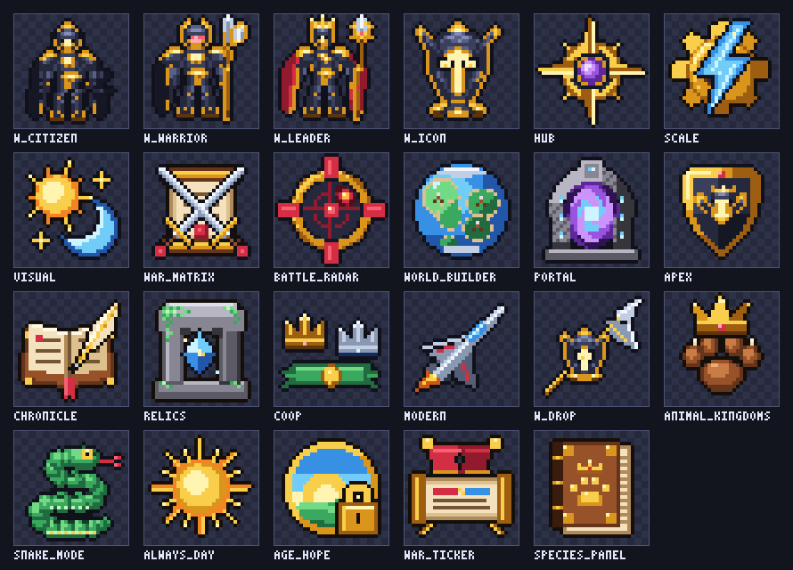
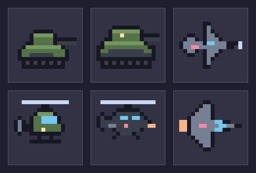

# worldbox-suite

a 9-mod classic pack, an opt-in modern warfare & geopolitics expansion, and a local web studio for WorldBox (Steam, saveVersion 17). built for giant multi-continent maps, bigger wars that stay playable, mossy ruins of fallen empires, co-op god mode, and messing with `.wbox` saves without hex editing anything.

catppuccin mocha everywhere.

## preview

**worldbox studio — world inspector, per-world mod profiles & direct steam save-slot export**


**co-op god console — two players sharing one live map with independent cameras**


**warden sentinel species & upgraded worldbox-style toolbar art (32×32 pixel art)**

<p align="center">
  
</p>

**modernage expansion — custom 32×32 pixel-art vehicle & aircraft sprites**

<p align="center">
  
</p>

## install

**windows (one-liner in powershell — no git needed):**

classic melee / fantasy core pack (9 mods, zero guns):
```powershell
irm https://raw.githubusercontent.com/Naftaliro/worldbox-suite/main/scripts/install.ps1 | iex
```

want the opt-in **ModernAge** expansion too (tier 1–3 firearms, tanks, jets, helicopters, radar/SAMs, governments & trade)?
```powershell
$env:WORLDBOX_MODERN=1; irm https://raw.githubusercontent.com/Naftaliro/worldbox-suite/main/scripts/install.ps1 | iex
```

both auto-detect your Steam WorldBox install across drives, download `NeoModLoader.dll` if you don't have it yet, install the mods cleanly into `Mods/`, install **WorldBox Studio** to `%LOCALAPPDATA%\WorldBoxSuite` (with a portable Python 3 runtime if Python isn't installed), and create a **WorldBox Studio** shortcut on your Desktop & Start Menu.

if you already cloned the repo:
* **windows:** double-click `install.bat` (or pass `-IncludeModern` to `scripts\install_mods.ps1`)
* **mac / linux:** `./scripts/install_mods.sh` (or `./scripts/install_mods.sh --modern`)

open WorldBox, go to settings, turn on **Experimental Mode**, and restart. NeoModLoader compiles each mod's `Code/*.cs` on startup so you don't need `.NET` installed just to play. once you're in a world, click the **WorldBox Suite** tab on the bottom power bar.

## what's in the pack

### classic core pack (`mods/` — installed by default, no firearms)

* **SuiteHub** (`bottom bar` / `F2`–`F5`): two native bottom tabs (**Suite: Powers** & a streamlined **Suite: Rules** bar) with color-distinct 32×32 WorldBox-style pixel icons and native tooltips. includes a collapsible top-right **Live War Ticker** (`F3`, zero map circles), an enriched **War & Diplomacy Monitor** (`F4`) showing exact war causes, starter info, casualties, real bilateral opinion breakdowns, 1-click camera jumps, and Force Peace controls, plus an in-game **Multi-Continent World Builder** (`F2`).
* **CoreScale** (`F8`): giant map presets (`12×12` up to `24×24` chunks) wired directly into WorldBox's native **Create New World** screen (*Colossal*, *Continental*, *Planetary*, *Leviathan*), **10×–60× Hyper Speed** (wired into both `Suite: Powers` and WorldBox's native hourglass), wider camera zoom, Turbo Mode, FPS governor, particle/flora throttling, strategic animation culling, 3-tier adaptive AI throttling, and army battalion compression.
* **VisualPolish** (`F9`, `F6` photo mode): **Extended HD Zoom** (`2.5×` default up to `Always HD` so buildings, citadels, highways, and units stay crisp when zoomed out instead of turning into low-res pixels), **Auto-Distinct Kingdom Colors**, **Enhanced Borders**, **Client-Side Always Day**, **Lock Age of Hope**, lighting presets, optional day/night cycle, soft vignette, closer zoom-in, and `F6` HUD toggle.
* **GrandWarfare** (`F10`): base-pack **Geopolitics** (6 governments & trade specialties) and **Real Alliance Trade** (allies exchange food, metals, and gold stockpiles + trade boats), **Divine Interventions** (*Armory Blessing*, *Anoint War Hero*, *Royal Dynasty Blessing*, *Mercenary Drop*), **2-Click Covert Espionage & Physical Spies** (pick Origin -> Target kingdoms on the map; spies travel on foot or by boat to infiltrate courts, stage coups, and unite realms peacefully, with optional AI auto-spies), naval broadsides, coastal bombardment, port blockades, supply-line attrition, and defense pacts.
* **LinkedContinents** (`F11`): links separate `.wbox` continent saves across ocean edges via `portal_queue.json` so fleets and expeditions cross between worlds.
* **EraChronicle** (`F7`): 5-tier kingdom era progression (*Dawn Age* through *High Hegemony*) with milestone buffs and background worker-thread JSON history snapshots readable in WorldBox Studio.
* **ApexFactions** (`F12`):
  * **Wardens (Custom Sapient Species) & Anti-Alien Countermeasures:** obsidian-and-gold armored Sentinels scaled to match vanilla creatures with 34 multi-frame animation sprites, calibrated 1v30 combat balance, **Warden Tradition Lock**, Sleeping Giant 3-strikes grudge escalation, plus **Anti-Alien Coalition & Xeno Reverse-Engineering** (empires pause petty wars and gain `+85` coalition opinion during Alien invasions, and slaying Aliens/UFOs yields fireproofing, salvaged mythril/adamantine, and reverse-engineered *Alien Blasters* after 3 kills).
  * **Auto-Founding Animal Kingdoms & 30-Species Personalities:** place 10+ wild animals together on unclaimed land and they awaken in their literal animal forms (`makeSapient()`) and found a kingdom automatically, complete with nature/lore-grounded diplomacy and behaviors — **Penguins** (*Tux Diplomacy Pact* +60 opinion, AI resists attacking them), **Snakes** (*Serpent's Guile* alliance backstabbers + toggleable *Peaceful Ambush* mode), **Raccoons & Foxes** (gold/resource heist raids), **Capybaras** (*Zen Commune*), **Bears**, **Wolves**, and all 30 WorldBox animals, managed from the scrollable **Species Manager** (`F12`).
* **WorldRelics** (`Alt+R`): **Wide Imperial Highways** (2–3 tile stone roads + narrow-strait bridges connecting major/allied cities), **Fortified Citadel Compounds** (double-walled 4-gate fortress rings around capitals with garrison buffs), city perimeter walls, toggleable **Dense Cities** mode, **Tectonic Events** (**Pangaea Drift** & **Empire-Safe Tectonic Rift**), and centuries-long decaying mossy ruins (`wall_order`/`wall_iron` -> `wall_ancient` -> `wall_green` -> `wall_wild`).
* **CoopHost** (`Alt+C`): host-authoritative co-op god mode. starts a zero-admin HTTP server on port `27777` (works over LAN, Tailscale, or `playit.gg` with a 4-digit join PIN) and serves a live interactive browser **Co-Op God Console** — independent pan/zoom camera, live units/cities/wars, simultaneous terrain brushes, unit/animal/tank/jet spawners, disasters, and a live guest cursor drawn right inside the host's WorldBox game.

### opt-in expansion (`expansions/ModernAge/` — `Alt+M`)

kept separate from the classic pack so melee playthroughs stay pure unless you opt in. rock-paper-scissors balance across 3 tech tiers, with custom 32×32 transparent pixel-art sprites for every tank, prop fighter, helicopter, and jet:

* **tier 1 (blackpowder & counters):** flintlock pistol, rifled musket, blunderbuss, hand culverin **vs.** Bastion bulletproof plate (60% bullet deflection), Aegis ward amulets, fast shock halberds (+45% vs gunners), and composite warbows.
* **tier 2 (industrial / early cold war):** light tanks, prop fighters, early gunship helicopters, and paved inter-city highways **vs.** anti-tank rifles (+165% vs armor) and flak AA autocannons (+185% vs aircraft).
* **tier 3 (modern warfare):** main battle tanks (MBTs), attack helicopters, supersonic jets, and automated capital **Radar & SAM defense domes** **vs.** guided anti-armor launchers and radar-guided SAM infantry.
* **governments & international trade:** 6 government types (*Monarchy, Republic, Collectivist, Merchant League, Military Junta, Technocracy*) and trade specialties (*Breadbasket, Armory State lend-lease, Maritime Hub, Research Hub*).

### worldbox studio & per-world launcher (`tools/`)

pure python 3 (no pip installs needed). double-click **`WorldBox Studio.bat`** on Windows (opens as a clean desktop-style app window) or **`WorldBox Studio.command`** on macOS, or run:

```bash
python3 -m tools.studio.server
```

open `http://127.0.0.1:8765` for:
* **per-world mod profiles & 1-click launch:** bind any save to **Classic Medieval** (zero guns) or **Modern Warfare** (enables `ModernAge`), then hit *Switch Mods & Launch WorldBox* — no digging through folders or `.dll` files.
* **world inspector, stitcher & direct save-slot export:** render `.wbox` maps, merge 2+ worlds (or built-in procedural continent templates) with stepping-stone archipelagos and war/peace presets, tweak saves, and export straight into WorldBox Steam slots (`save1`–`save30`) with generated `map.meta` and preview PNGs.
* **crash & mod diagnostics:** parses Unity's `Player.log` live to show green/red health badges per mod, compile errors or stack traces, and a 1-click *Copy Diagnostic Report* button.
* **chronicle viewer & mod manager:** SVG population timelines, custom mod profiles, and `.zip` save backups.

## building it

```bash
python3 -m unittest discover -s tests -v
python3 scripts/validate_suite.py
./scripts/build_all.sh
```

to compile-check all 10 C# mods locally, copy `worldbox_Data/Managed/*.dll`, `NeoModLoader.dll`, and `0Harmony.dll` into `local/libs/` (gitignored).

## license

[MIT](LICENSE)

---

worldbox-suite is an unofficial, fan-made mod pack and toolkit. not affiliated with or endorsed by Maxim Karpenko or WorldBox.
