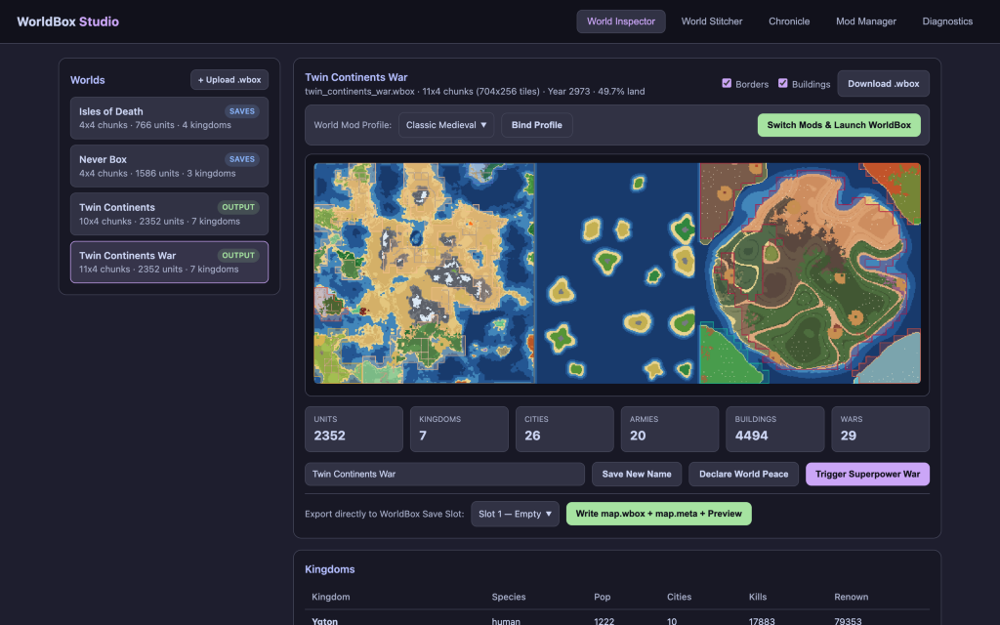
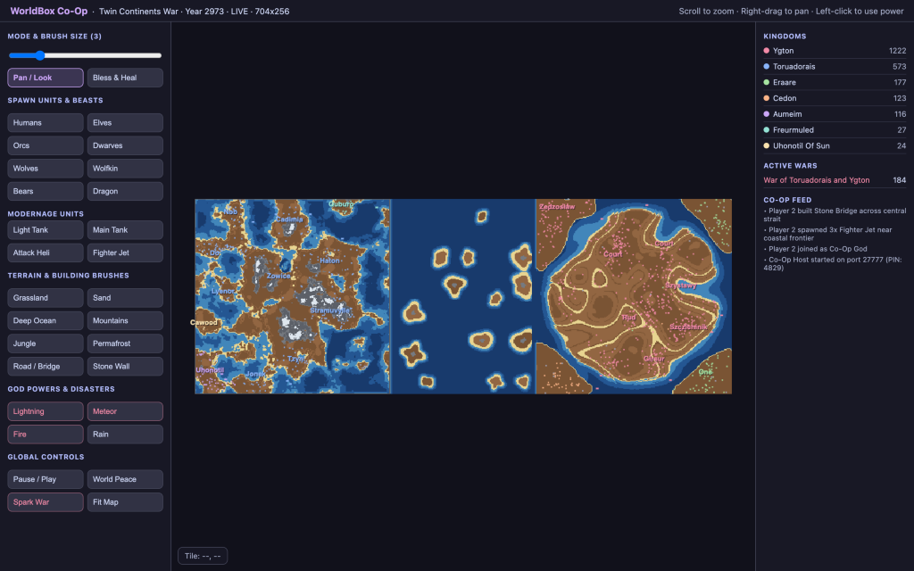

# worldbox-suite

a 9-mod classic pack, an opt-in modern warfare & geopolitics expansion, and a local web studio for WorldBox (Steam, saveVersion 17). built for giant multi-continent maps, bigger wars that stay playable, mossy ruins of fallen empires, co-op god mode, and messing with `.wbox` saves without hex editing anything.

catppuccin mocha everywhere.

## preview

**worldbox studio — world inspector, per-world mod profiles & direct steam save-slot export**



**co-op god console — two players sharing one live map with independent cameras**



**modernage expansion — custom 32×32 pixel-art vehicle & aircraft sprites**

<p align="center">
  
</p>

## install

**windows (one-liner in powershell — no git needed):**

classic melee / fantasy core pack (9 mods, zero guns):
```powershell
irm https://raw.githubusercontent.com/Naftaliro/worldbox-suite/main/scripts/install.ps1 | iex
```

want the opt-in **ModernAge** expansion too (tier 1–3 firearms, tanks, jets, helicopters, radar/SAMs, governments & trade)?
```powershell
$env:WORLDBOX_MODERN=1; irm https://raw.githubusercontent.com/Naftaliro/worldbox-suite/main/scripts/install.ps1 | iex
```

both auto-detect your Steam WorldBox install across drives, download `NeoModLoader.dll` if you don't have it yet, and install the mods cleanly into `Mods/`.

if you already cloned the repo:
* **windows:** double-click `install.bat` (or pass `-IncludeModern` to `scripts\install_mods.ps1`)
* **mac / linux:** `./scripts/install_mods.sh` (or `./scripts/install_mods.sh --modern`)

open WorldBox, go to settings, turn on **Experimental Mode**, and restart. NeoModLoader compiles each mod's `Code/*.cs` on startup so you don't need `.NET` installed just to play. once you're in a world, click the **WorldBox Suite** tab on the bottom power bar.

## what's in the pack

### classic core pack (`mods/` — installed by default, no firearms)

* **SuiteHub** (`bottom bar` / `F2`–`F5`): native WorldBox Suite tab on the bottom power bar with buttons for every installed module. includes the floating **War & Diplomacy Monitor** (`F4`) with opinion scores and 1-click camera jumps, pulsing **Battlefield Conflict Radar** (`F3`), and an in-game **Multi-Continent World Builder** (`F2`).
* **CoreScale** (`F8`): giant map presets (`12×12` up to `24×24` chunks), wider camera zoom, multi-core parallel job tuning, strategic animation culling, 3-tier adaptive AI throttling (3k/8k/15k pop), and army battalion compression.
* **VisualPolish** (`F9`, `F6` photo mode): lighting presets (crisp, golden hour, moonlit night, parchment atlas, mocha twilight), optional day/night cycle, soft vignette, closer zoom-in, brighter strategic borders, and `F6` HUD toggle.
* **GrandWarfare** (`F10`): ship-to-ship broadsides, coastal bombardment of shoreline troops, naval blockades that starve coastal garrisons when enemy fleets hold within 24 tiles, supply-line attrition outside friendly cities, and defense pacts.
* **LinkedContinents** (`F11`): links separate `.wbox` continent saves across ocean edges via `portal_queue.json` so fleets and expeditions cross between worlds.
* **EraChronicle** (`F7`): 5-tier kingdom era progression (*Dawn Age* through *High Hegemony*) with milestone buffs and JSON history snapshots readable in WorldBox Studio.
* **ApexFactions** (`F12`): the **Warden** "Sleeping Giant" doctrine (strong, peaceful humans who never start wars, rally relentlessly if attacked, and track a 3-strikes grudge per aggressor — 15% ceasefire mercy on strike #1, 5% on strike #2, zero mercy on strike #3+), instant species awakener (`civ_wolf` + `makeSapient` for all wild animals), and feral pack domains (*Land of the Wolves*, *Land of the Bears*, etc.).
* **WorldRelics** (`Alt+R`): large cities fortify their borders with gated walls, friendly cities across narrow ocean straits build stone sea bridges, and fallen empires leave behind walls and roadworks that slowly weather over 100–300+ years (`wall_order`/`wall_iron` -> `wall_ancient` -> mossy `wall_green` -> vine-covered `wall_wild`) while younger tribes settle inside the ruins.
* **CoopHost** (`Alt+C`): host-authoritative co-op god mode. starts a zero-admin HTTP server on port `27777` (works over LAN, Tailscale, or `playit.gg` with a 4-digit join PIN) and serves a live interactive browser **Co-Op God Console** — independent pan/zoom camera, live units/cities/wars, simultaneous terrain brushes, unit/animal/tank/jet spawners, disasters, and a live guest cursor drawn right inside the host's WorldBox game.

### opt-in expansion (`expansions/ModernAge/` — `Alt+M`)

kept separate from the classic pack so melee playthroughs stay pure unless you opt in. rock-paper-scissors balance across 3 tech tiers, with custom 32×32 transparent pixel-art sprites for every tank, prop fighter, helicopter, and jet:

* **tier 1 (blackpowder & counters):** flintlock pistol, rifled musket, blunderbuss, hand culverin **vs.** Bastion bulletproof plate (60% bullet deflection), Aegis ward amulets, fast shock halberds (+45% vs gunners), and composite warbows.
* **tier 2 (industrial / early cold war):** light tanks, prop fighters, early gunship helicopters, and paved inter-city highways **vs.** anti-tank rifles (+165% vs armor) and flak AA autocannons (+185% vs aircraft).
* **tier 3 (modern warfare):** main battle tanks (MBTs), attack helicopters, supersonic jets, and automated capital **Radar & SAM defense domes** **vs.** guided anti-armor launchers and radar-guided SAM infantry.
* **governments & international trade:** 6 government types (*Monarchy, Republic, Collectivist, Merchant League, Military Junta, Technocracy*) and trade specialties (*Breadbasket, Armory State lend-lease, Maritime Hub, Research Hub*).

### worldbox studio & per-world launcher (`tools/`)

pure python 3 (no pip installs needed). double-click **`WorldBox Studio.bat`** on Windows (opens as a clean desktop-style app window) or **`WorldBox Studio.command`** on macOS, or run:

```bash
python3 -m tools.studio.server
```

open `http://127.0.0.1:8765` for:
* **per-world mod profiles & 1-click launch:** bind any save to **Classic Medieval** (zero guns) or **Modern Warfare** (enables `ModernAge`), then hit *Switch Mods & Launch WorldBox* — no digging through folders or `.dll` files.
* **world inspector, stitcher & direct save-slot export:** render `.wbox` maps, merge 2+ worlds with stepping-stone archipelagos and war/peace presets, tweak saves, and export straight into WorldBox Steam slots (`save1`–`save30`) with generated `map.meta` and preview PNGs.
* **crash & mod diagnostics:** parses Unity's `Player.log` live to show green/red health badges per mod, compile errors or stack traces, and a 1-click *Copy Diagnostic Report* button.
* **chronicle viewer & mod manager:** SVG population timelines, custom mod profiles, and `.zip` save backups.

## building it

```bash
python3 -m unittest discover -s tests -v
./scripts/build_all.sh
```

to compile-check all 10 C# mods locally, copy `worldbox_Data/Managed/*.dll`, `NeoModLoader.dll`, and `0Harmony.dll` into `local/libs/` (gitignored).

## license

[MIT](LICENSE)

---

worldbox-suite is an unofficial, fan-made mod pack and toolkit. not affiliated with or endorsed by Maxim Karpenko or WorldBox.
